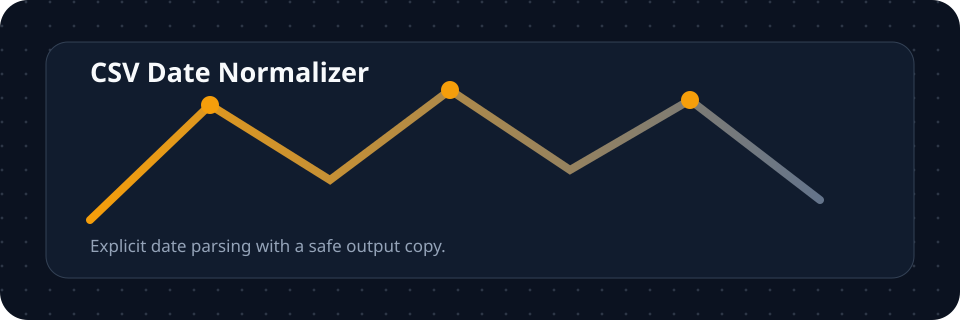

<div align="center">


[](LICENSE)



</div>

## :compass: Overview

A dependency-free CSV utility that converts one chosen date column into a consistent format, preserves other columns, and reports rows that could not be parsed.

## :sparkles: Features

- :white_check_mark: Requires an explicit source date format instead of guessing
- :white_check_mark: Writes a new output file and preserves the original input
- :white_check_mark: Reports invalid rows without silently changing their values
- :white_check_mark: Supports custom delimiters and UTF-8 CSV files

## :clapper: Demo

```bash
python main.py examples/dates.csv normalized.csv --column created_at --from-format '%d/%m/%Y'
```

The example runs locally; no hosted service or upload is required.

## :rocket: Quick Start

```bash
python -m pip install -r requirements.txt
python main.py examples/dates.csv normalized.csv --column created_at --from-format '%d/%m/%Y'
```

Run `python main.py --help` to see all supported options.

## :toolbox: Tech Stack

- Python 3.10+ standard library (csv and datetime)
- Automated tests: unittest
- Local-first processing

## :file_folder: Folder Structure

```text
csv-date-normalizer/\n├── main.py\n├── requirements.txt\n├── tests/test_core.py\n├── examples/dates.csv\n└── assets/illustration.svg
```

## :world_map: Roadmap

- [x] Core workflow and CLI
- [x] Example input and tests
- [ ] Additional report formats
- [ ] Continuous integration on supported platforms

## :handshake: Contributing

Issues and pull requests are welcome. Keep changes focused, document behavior changes, and add tests for new features.

## :page_facing_up: License

MIT - see [LICENSE](LICENSE).

<div align="center"></div>
